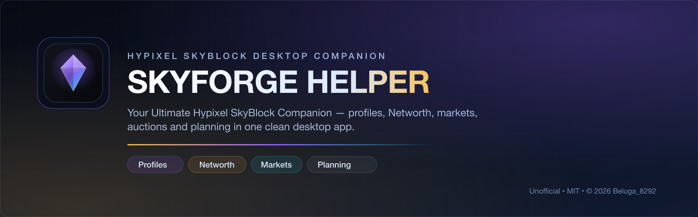
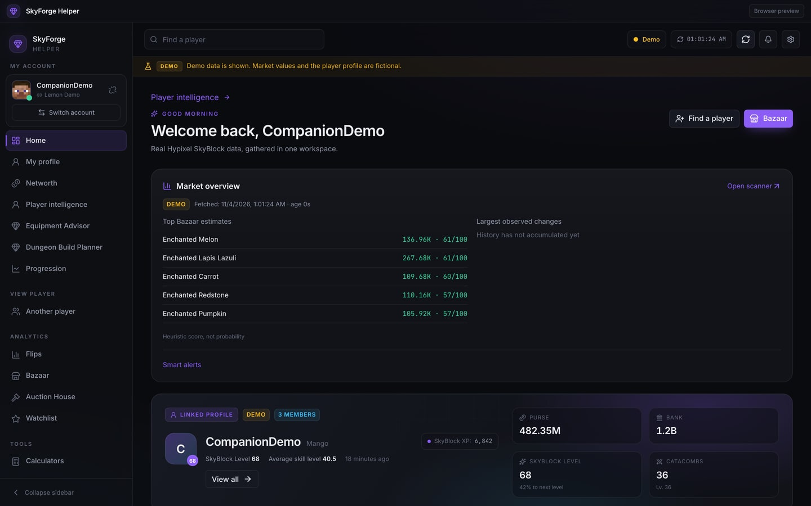
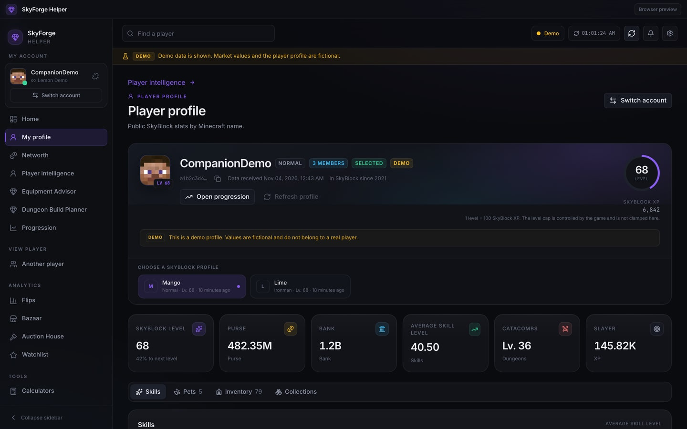
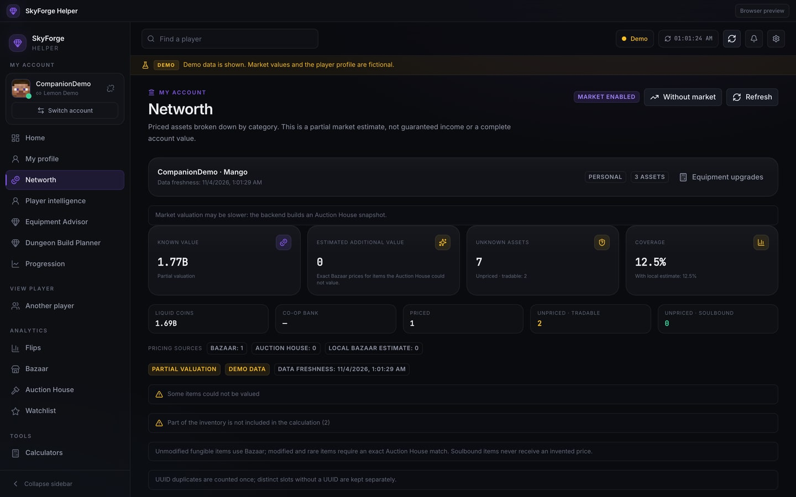
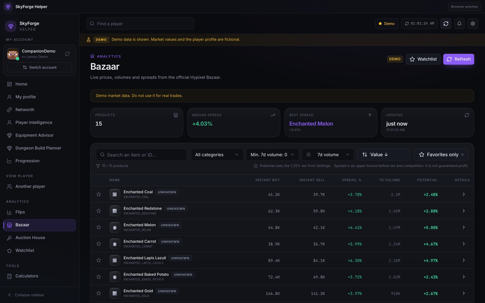
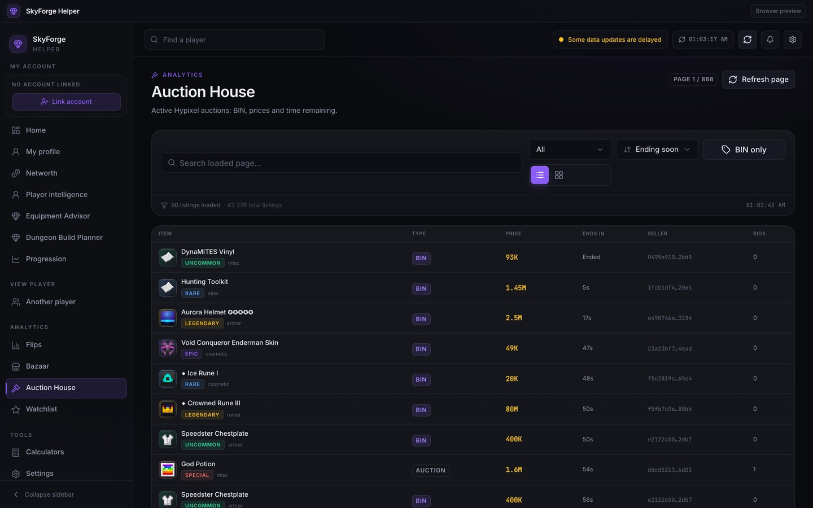
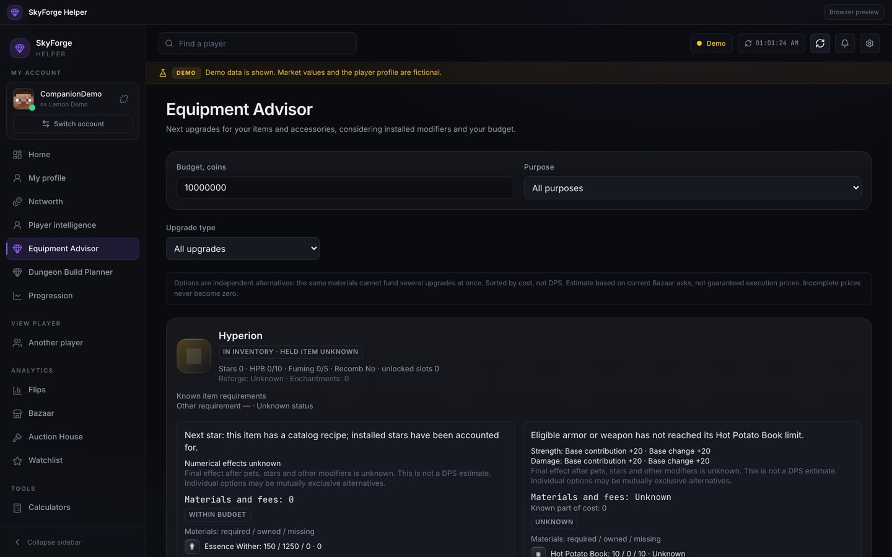
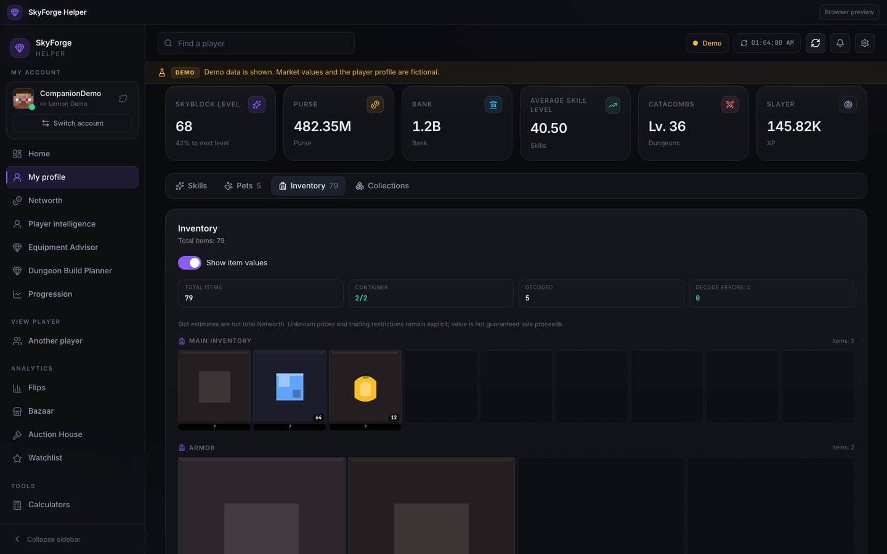
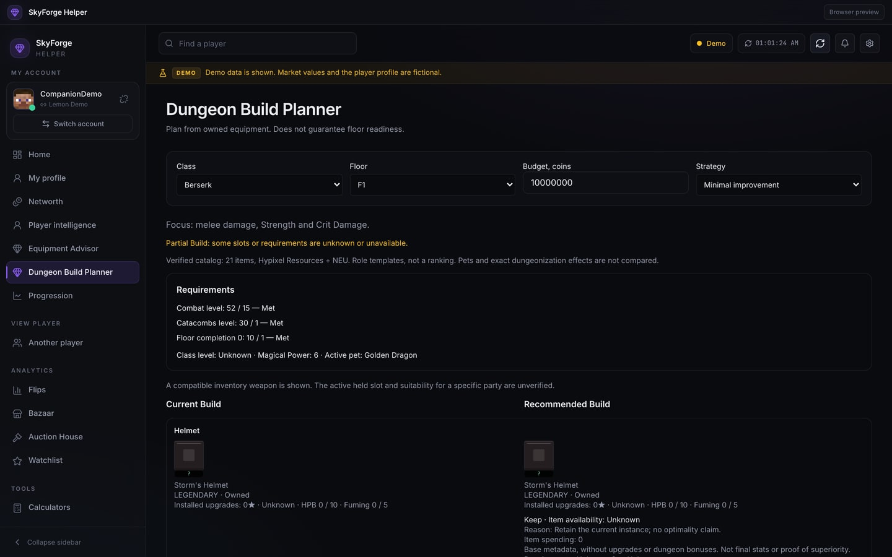

<p align="center"><a href="README.md"><b>English</b></a> · <a href="README.ru.md">Русский</a></p>

<p align="center">
  
</p>

<h1 align="center">SkyForge Helper</h1>
<p align="center"><b>Your Ultimate Hypixel SkyBlock Companion</b></p>
<p align="center">
  Explore profiles, understand your Networth, follow Bazaar and Auction House markets, plan equipment and manage your inventory — in one polished desktop app.
</p>

<p align="center">
  <a href="https://github.com/Beluga8292/SkyForge-Helper/releases/download/v0.5.0-rc.6/SkyForge-Helper_0.5.0-rc.6_windows-x86_64-setup.exe"></a>
  &nbsp;
  <a href="https://github.com/Beluga8292/SkyForge-Helper/releases/download/v0.5.0-rc.6/SkyForge-Helper-macOS-arm64.dmg"></a>
  &nbsp;
  <a href="https://discord.gg/bX3md4uepp"></a>
</p>

<p align="center">
  <a href="https://github.com/Beluga8292/SkyForge-Helper/actions/workflows/ci.yml"></a>
  <a href="https://github.com/Beluga8292/SkyForge-Helper/actions/workflows/installers.yml"></a>
  
  
  
</p>

> **Downloads:** the buttons above download the validated Windows NSIS setup and macOS Apple-silicon DMG. SHA-256 checksums and release notes are on the [Releases page](https://github.com/Beluga8292/SkyForge-Helper/releases/tag/v0.5.0-rc.6). Installer builds are produced and tested by the [installer workflow](https://github.com/Beluga8292/SkyForge-Helper/actions/workflows/installers.yml).

---

## Built for SkyBlock players

SkyForge Helper brings the information you check every session into one fast desktop workspace. No mod loaders, no game-file changes and no setup marathon — install it, open it and connect your profile when you want personal data.



### Player intelligence
Profiles, skills, Catacombs, Slayers, pets, collections and progression in a readable overview. Missing API fields are shown as unknown instead of being replaced with zero.



### Networth you can trust
Known value, estimated additional value, unpriced assets and coverage in one breakdown. One broken item never invalidates the whole calculation, and unknown prices are never presented as real value. Co-op bank is excluded from personal Networth.



### Bazaar intelligence
Live prices, spreads, volume and after-tax estimates, with clear warnings that a spread is not guaranteed profit.



### Auction House
BIN listings, filters, NBT-aware item matching, valuations and item textures in table and grid views.



### Equipment Advisor
Compare upgrades for the gear you own, including known material costs, essence, reforges and enchantments. Partial data stays clearly marked; the app does not promise DPS or guaranteed dungeon clears.



### Inventory and item values
Minecraft-style slots, item textures, tooltips and an optional stack-value overlay. Incomplete containers stay visible as incomplete.



### Dungeon Build Planner
Class and floor templates, requirement checks, owned-gear retention and a shared build budget with explicit partial results.



### Goals, Watchlist and calculators
Save goals, watch market items and use the built-in calculators for the numbers you check most often. Personal data stays on your computer; market data comes from the hosted backend.

---

## Everything in one app

| | |
| --- | --- |
| **Profiles** | Skills, Catacombs, Slayers, pets, collections and progression |
| **Assets** | Inventory, storage and an honest partial Networth |
| **Markets** | Bazaar prices, spreads, Auction House browsing and smart flips |
| **Equipment** | Upgrade comparisons, materials, essence, reforges and enchantments |
| **Planning** | Dungeon builds, goals, watchlist and calculators |
| **Quality of life** | Item textures, English/Russian UI and signed automatic updates |

---

## Installation

### Windows 10/11 (x64)

1. Download `SkyForge-Helper_0.5.0-rc.6_windows-x86_64-setup.exe` from the [Releases page](https://github.com/Beluga8292/SkyForge-Helper/releases/tag/v0.5.0-rc.6).
2. Run the installer. It installs for the current user and does not require administrator rights.
3. Open the app from the Start Menu.

WebView2 is installed automatically if it is missing, which requires an internet connection.

### macOS 12+ (Apple silicon)

1. Download `SkyForge-Helper-macOS-arm64.dmg` from the [Releases page](https://github.com/Beluga8292/SkyForge-Helper/releases/tag/v0.5.0-rc.6).
2. Open the DMG.
3. Drag **SkyForge Helper** into **Applications**.
4. Launch it from Applications.

No Terminal, Python, Node.js, Rust, Docker, PostgreSQL, Redis, backend URL or Hypixel API key is required.

### Compatibility note

The installed app currently keeps the legacy internal name **SkyBlock Companion** for its bundle, data folder and updater identity. This preserves existing settings, account binding, Goals, Watchlist and the update path. The window, interface and documentation are branded **SkyForge Helper**.

---

## FAQ

<details>
<summary><b>What is SkyForge Helper?</b></summary>
A standalone desktop companion for Hypixel SkyBlock. It reads public and profile data through a hosted backend and presents profiles, Networth, markets, auctions, equipment and planning tools.
</details>

<details>
<summary><b>Is it free?</b></summary>
Yes. SkyForge Helper is free to use and the source is available under the MIT License. There is no paid tier or subscription.
</details>

<details>
<summary><b>Is it safe?</b></summary>
It is open source, does not inject code into Minecraft and does not require your Hypixel API key for normal use. Open source is not a security guarantee; review the code and use official release files. The hosted backend keeps its own API key server-side.
</details>

<details>
<summary><b>Is it a Minecraft mod?</b></summary>
No. It is a separate desktop application. It does not modify Minecraft, install mod loaders or change game files.
</details>

<details>
<summary><b>Does it require a Hypixel API key?</b></summary>
No for normal use. Advanced users may choose a direct/BYOK mode, where a key is stored in the operating-system credential vault. Never share a key in an issue, screenshot or Discord message.
</details>

<details>
<summary><b>Do I need Minecraft installed?</b></summary>
No. Minecraft is not required to run the app. You need a Hypixel SkyBlock account/profile to use personal profile features; market pages work without linking an account.
</details>

<details>
<summary><b>Does it support Windows?</b></summary>
Yes. Windows 10/11 x64 is supported with a per-user NSIS installer.
</details>

<details>
<summary><b>Does it support macOS?</b></summary>
Yes. macOS 12 or newer on Apple silicon (ARM64) is supported. Intel Macs and Linux are not release targets.
</details>

<details>
<summary><b>How do updates work?</b></summary>
The app checks a signed Tauri update manifest over HTTPS, verifies the artifact against the embedded public key and then offers the update inside the app. It never silently installs from an unverified source.
</details>

<details>
<summary><b>Are my settings saved?</b></summary>
Yes. Settings, account binding, Goals and Watchlist are stored locally in SQLite and survive updates. Uninstalling normally leaves user data in place; remove the app data folder manually only if you intend to reset it.
</details>

<details>
<summary><b>How do I report a bug?</b></summary>
Open a GitHub issue with the app version, operating system, steps to reproduce and a screenshot if safe. Remove API keys, tokens, full UUIDs and private profile details. Use the bug report template.
</details>

<details>
<summary><b>Where can I get help?</b></summary>
Join the [Discord community](https://discord.gg/bX3md4uepp) or open a GitHub issue. Do not post secrets or private account data.
</details>

---

## Troubleshooting

- **Windows SmartScreen warning:** current installers are not code-signed with an Authenticode certificate. Only run files downloaded from this repository's official Releases. Do not disable SmartScreen globally.
- **macOS Gatekeeper warning:** test builds use ad-hoc signing and are not notarized. Right-click → Open is a local workaround; do not disable Gatekeeper globally.
- **No profile data:** link a Minecraft account, check the connection status and remember that stale or partial API data is shown honestly rather than replaced with fake values.
- **Backend unavailable:** market pages may show the last cached snapshot with a warning. Retry later; the app does not hide stale data.
- **Wrong platform:** Windows builds are x64; macOS builds are Apple silicon only. There is no Linux or Intel Mac release.

---

## Community and support

- **Discord:** [discord.gg/bX3md4uepp](https://discord.gg/bX3md4uepp)
- **Issues:** [github.com/Beluga8292/SkyForge-Helper/issues](https://github.com/Beluga8292/SkyForge-Helper/issues)
- **Security reports:** [SECURITY.md](SECURITY.md)
- **Contributing:** [CONTRIBUTING.md](CONTRIBUTING.md)

Screenshots use the app's isolated demo profile (fictional player and market data), except the Auction House image, which shows public listings without a linked account. No private UUID, balance or API key is shown.

---

## Development

```sh
npm ci
npm run typecheck
npm test
npm run build
npm run tauri:dev
```

See [docs/BUILDING.md](docs/BUILDING.md) for platform prerequisites and the optional backend. Never put a Hypixel API key in `VITE_*`, Git or a client binary.

---

## License and credits

Copyright © **2026 Beluga_8292**. Licensed under the [MIT License](LICENSE). You may study, fork, modify and redistribute the code under MIT; keep the copyright and license notices.

FurfSky Reborn is **All Rights Reserved** and is not bundled. Users may import a pack they have legitimately obtained. Minecraft, Hypixel and related marks belong to their respective owners. See [BRANDING.md](BRANDING.md) and [THIRD_PARTY_NOTICES.md](THIRD_PARTY_NOTICES.md).

**SkyForge Helper is an unofficial fan project and is not affiliated with or endorsed by Hypixel Inc., Mojang Studios or Microsoft.**
