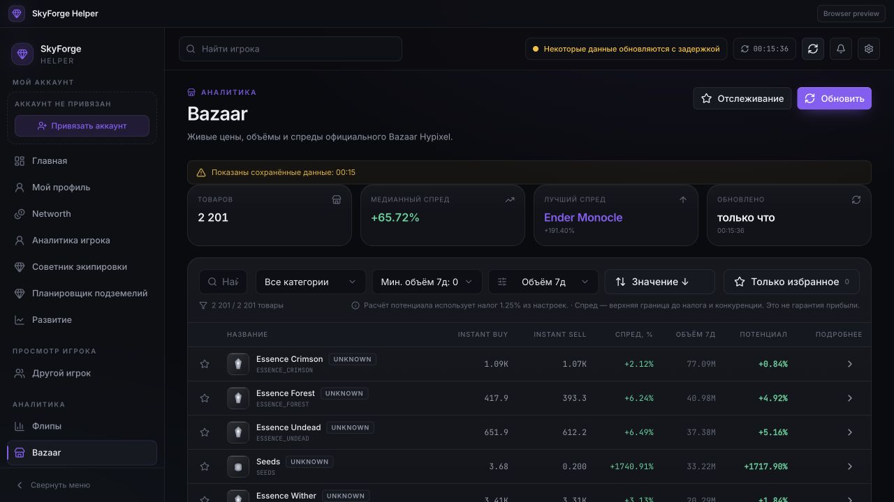

# SkyForge Helper

A standalone desktop companion for **Hypixel SkyBlock**, developed by
**Beluga_8292**. Explore your profile, understand your assets, compare equipment
and follow the market from a Minecraft-inspired desktop interface.

Previously named **SkyBlock Companion**. This repository contains **unreleased
development newer than 0.5.0-rc.5**. Its inherited package version does not mean
that the new brand or Stage 8 changes are already published.



Development screenshot with an unbound account and cached public market data.

## What you can do

| Area | Features |
| --- | --- |
| Profile | Profile Analyzer, skills, Catacombs, Slayers, pets and progression |
| Assets | Networth with explicit unknown/partial values, inventory and storage |
| Market | Bazaar, Auction House, price history, Smart Flip Finder |
| Equipment | Equipment Advisor 2.0, existing-upgrade comparisons and resource costs |
| Planning | Inventory Value Overlay and Dungeon Build Planner |
| Personal | Goals, Watchlist and locally imported Minecraft item textures |
| Updates | Existing signed updater channel, preserving legacy install identity |

The published **SkyBlock Companion 0.5.0-rc.5** has its original profile/market,
Networth, progression, Goals/Watchlist, textures and updater feature set. The
expanded Stage 8 advisor, smart flipping, inventory overlay and dungeon planner
are in this development tree; do not assume they exist in that published binary.
Uncertain API fields, requirements, prices and incomplete inventories stay
explicitly unknown. Market estimates do not guarantee profits or floor clears.

## Install and platform status

- **macOS ARM64:** an earlier rc.5 exists under the former name. New compatibility
  packaging is prepared but not validated by GitHub Actions yet. Developer ID
  signing and notarization are unavailable; ad-hoc test builds may trigger
  Gatekeeper warnings. Do not bypass operating-system security warnings blindly.
- **Windows x64:** MSVC/NSIS EXE and MSI build workflow prepared; compilation,
  install/update/uninstall and runtime E2E are **not yet verified**. Authenticode
  certificate unavailable. Unsigned test builds are not production installers.
- **Linux / macOS Intel:** not release targets in this preparation.

An official GitHub account/repository URL has not been confirmed, so there is no
invented release-download link. The intended repository name is **SkyForge-Helper**.
After owner-approved publication, verified official links will be added here.
CI artifacts are test packages, never automatically GitHub Releases or updates.

The new UI is SkyForge Helper, while native product/install identity remains
SkyBlock Companion pending [migration verification](docs/REBRANDING.md). Keep the
original installer until upgrade compatibility has been tested. No new release
is published by this repository preparation.

## Build from source

Requires Node **24**, Rust stable, platform Tauri 2 prerequisites, and Python
**3.12** for the optional FastAPI backend and repository tooling.

```sh
npm ci
npm run typecheck
npm test
npm run build
npm run tauri:dev
```

For backend development:

```sh
python3.12 -m venv backend/.venv
backend/.venv/bin/python -m pip install -r backend/requirements-ci.lock
backend/.venv/bin/python -m pip install --no-deps -e backend
cp backend/.env.example backend/.env
backend/.venv/bin/python -m pytest backend/tests -q
```

Configure your own backend environment locally. Never put Hypixel keys in VITE_*
variables, Git or client binaries. The desktop's optional Direct/BYOK mode uses
the OS credential vault. Backend keys stay in server-side configuration.
[Build and validation details](docs/BUILDING.md) · [Security](docs/SECURITY.md).

## Source, contributions and authorship

Copyright (c) **2026 Beluga_8292**. Licensed under the standard [MIT License](LICENSE).
You may study, fork, modify and redistribute the code under MIT. Include the
copyright and license notices in copies or substantial portions; MIT does not
prohibit forks or modifications. Pull requests and fixes are welcome once the
repository is published.

Identify derivative builds clearly; see [branding guidance](BRANDING.md).
[Third-party notices](THIRD_PARTY_NOTICES.md) apply independently. FurfSky Reborn
is **All Rights Reserved**, is not bundled, and must be imported locally by a
user who has obtained the pack. Game textures/trademarks are not relicensed MIT.

Screenshots containing real account/profile data and internal verification logs
are deliberately excluded from the public source preparation.

SkyForge Helper is not affiliated with or endorsed by Hypixel Inc., Mojang or
Microsoft. Their names and assets belong to their respective owners.
