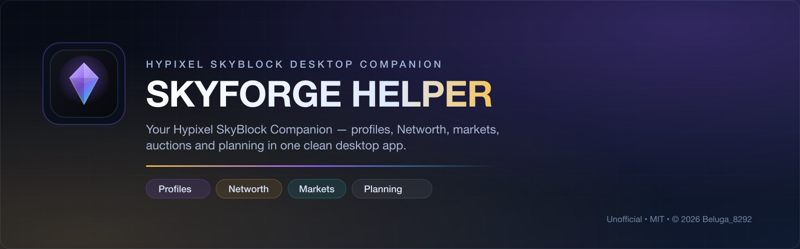
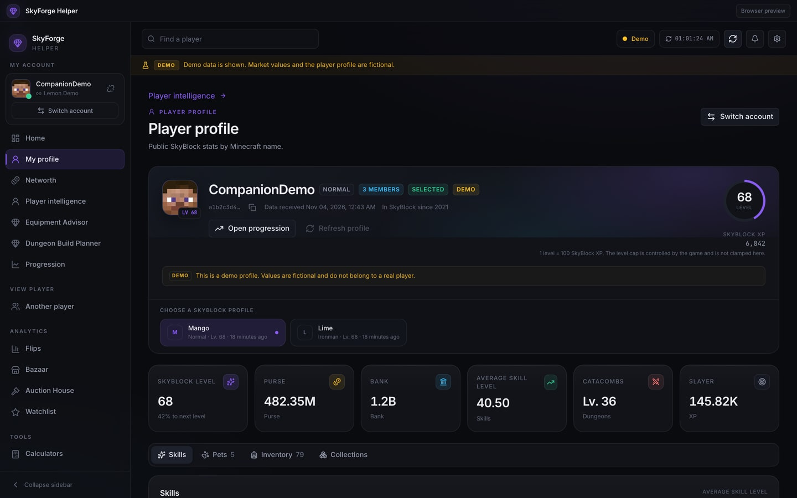
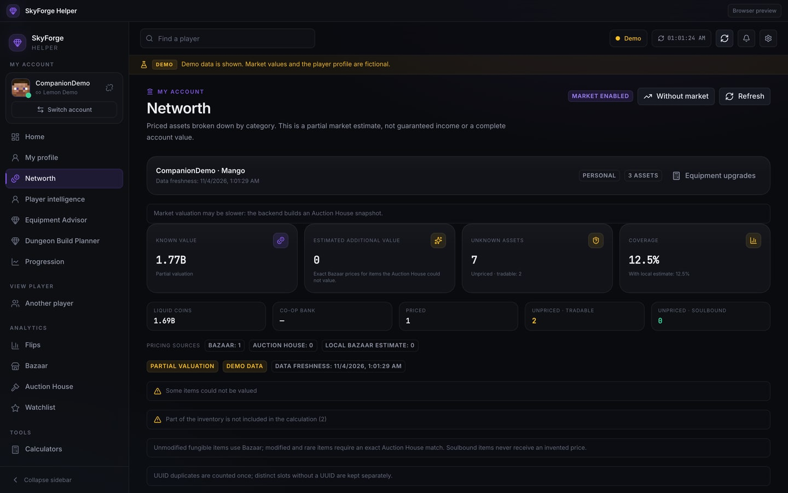
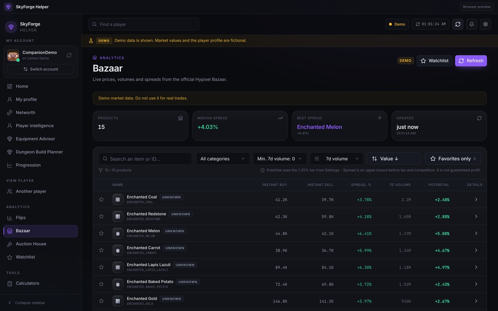
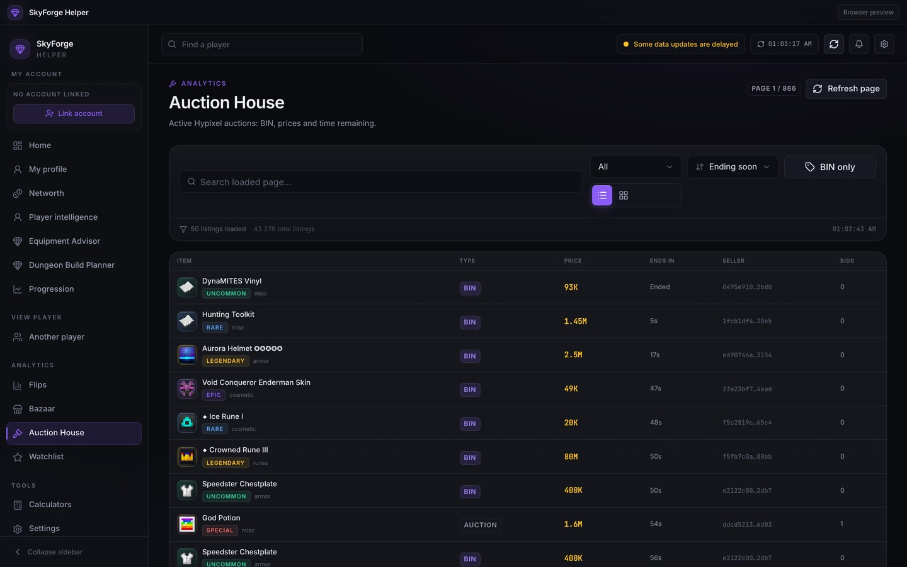
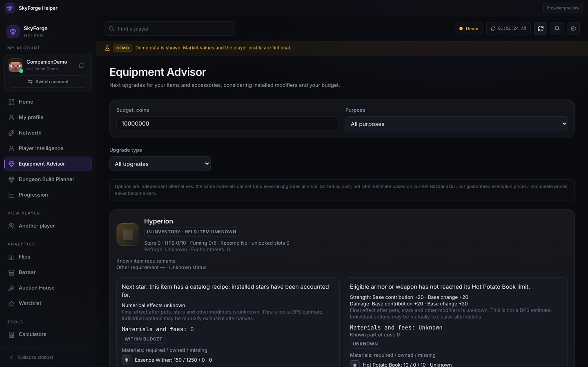
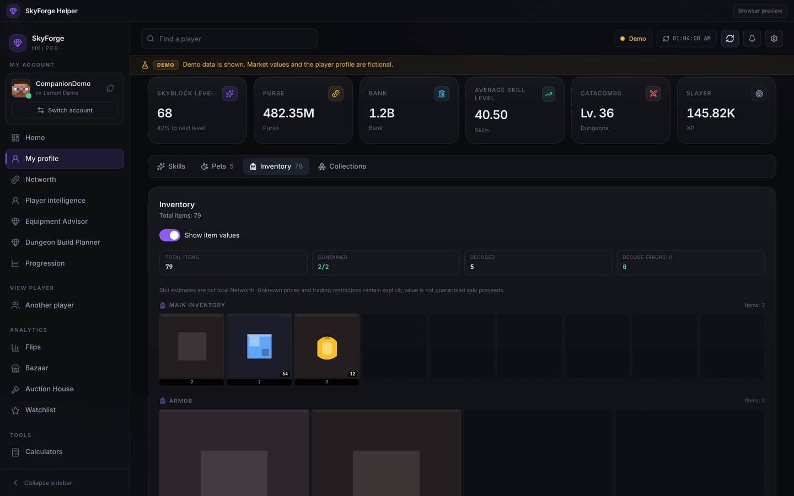
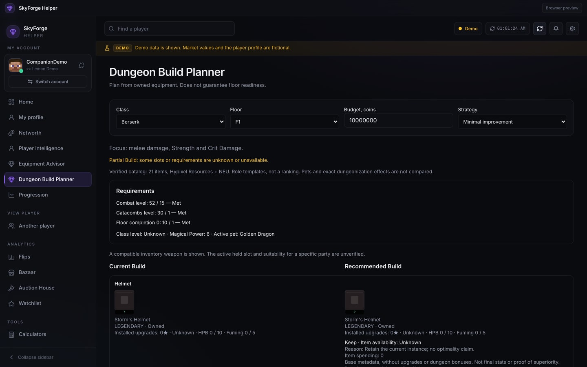
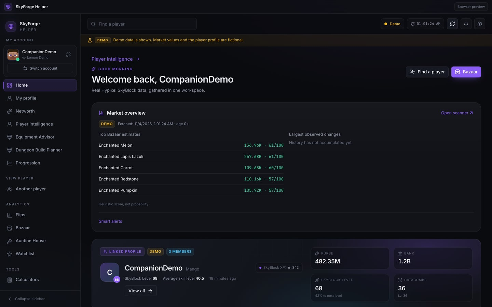

<p align="center"><a href="README.md">English</a> · <a href="README.ru.md"><b>Русский</b></a></p>

<p align="center">
  
</p>

<h1 align="center">SkyForge Helper</h1>
<p align="center"><b>Твой компаньон для Hypixel SkyBlock</b></p>
<p align="center">
  Профили, Networth, Bazaar, Auction House, планирование экипировки и анализ инвентаря — в одном аккуратном desktop-приложении.
</p>

<p align="center">
  
  
  
  
</p>

<p align="center">
  <a href="#загрузка"></a>
  &nbsp;
  <a href="https://discord.gg/bX3md4uepp"></a>
</p>

> **Статус установщиков:** подписанная сборка `0.5.0-rc.5` уже доступна в существующем канале обновлений под прежним именем **SkyBlock Companion**. Новые установщики **SkyForge Helper** для Windows и macOS проходят проверку в CI и **ещё не опубликованы как GitHub Releases**. Эта страница не ссылается на файлы, которых не существует.

---

## Загрузка

| Платформа | Пакет | Статус |
| --- | --- | --- |
| **Windows 10/11 x64** | `SkyForge-Helper-Setup-x64.exe` (NSIS, установка для пользователя) | Сборка и проверка чистой установки подготовлены в [GitHub Actions](https://github.com/Beluga8292/SkyForge-Helper/actions/workflows/installers.yml). **Публичного релиза пока нет.** |
| **macOS 12+ ARM64** | `SkyForge-Helper-macOS-arm64.dmg` | Сборка DMG подготовлена в [GitHub Actions](https://github.com/Beluga8292/SkyForge-Helper/actions/workflows/installers.yml). **Публичного релиза пока нет.** Ad-hoc подпись, без notarization. |

Публичное обновление `0.5.0-rc.5` сохраняет старую внутреннюю идентичность **SkyBlock Companion**, чтобы у существующих пользователей не потерялись настройки, привязка аккаунта, Watchlist и путь обновлений. Полное переименование без проверенной миграции рискует создать вторую установку или повредить данные. Подробнее — в [описании ребрендинга](docs/REBRANDING.md).

**Обычному пользователю не нужны терминал, Python, Node.js, Rust, PostgreSQL или Redis.** Приложение работает через размещённый production-backend. Инструкция для сборки из исходников предназначена разработчикам.

---

## Что внутри

### Аналитика игрока
Профили, навыки, Catacombs, Slayers, питомцы, коллекции и прогресс. Недостающие поля API показываются как неизвестные, а не как ноль.



### Честный Networth
Известная стоимость, предполагаемая дополнительная, неоценённые предметы и покрытие. Ошибка одного предмета не ломает весь расчёт, а неизвестная цена никогда не превращается в реальную. Банк кооператива не входит в личный Networth.



### Аналитика Bazaar
Живые цены, спреды, объёмы и оценки после налога — с явным предупреждением, что спред не гарантирует прибыль.



### Auction House
BIN-лоты, фильтры, NBT-совместимое сопоставление, оценки и настоящие текстуры предметов в таблице и сетке.



### Советник по экипировке
Варианты улучшений для имеющихся предметов с известными материалами, эссенцией, рефорджами и зачарованиями. Приложение не обещает DPS или гарантированный проход данжа.



### Инвентарь
Слоты в стиле Minecraft, текстуры предметов, подсказки и необязательные плашки стоимости стопки. Неполные контейнеры честно помечаются как неполные.



### Планировщик данжей
Шаблоны классов и этажей, проверка требований, сохранение имеющейся экипировки и общий бюджет сборки с явными частичными результатами.



### Dashboard, Goals и Watchlist
Единый обзор движения рынка, оповещений, привязанного профиля и сохранённых целей. Личные данные остаются локально, рыночные приходят с размещённого backend.



### Автоматические обновления
Подписанные Tauri-обновления по HTTPS. Встроенный публичный ключ проверяет артефакт, а предложение обновиться появляется прямо в приложении — без тихой установки из непроверенного источника.

---

## Статус функций

| Возможность | Подписанная rc.5 | Ветка разработки |
| --- | --- | --- |
| Профиль, навыки, питомцы, Slayers, данжи | **Доступно** | Доступно |
| Честный частичный Networth | **Доступно** | Доступно |
| Bazaar и умные оповещения | **Доступно** | Доступно |
| Auction House с NBT-визуалом | **Доступно** | Доступно |
| Советник по экипировке | **Доступно** | Доступно |
| Оверлей стоимости инвентаря | **Доступно** | Доступно |
| Планировщик данжей | **Доступно** | Доступно |
| Goals и Watchlist | **Доступно** | Доступно |
| Ребрендинг SkyForge Helper и новые установщики | Нет в опубликованном бинарнике | **Только исходники** |
| Полное переименование native-приложения | Не выпущено | **Заблокировано до проверки обновления** |
| Публикация установщиков Windows/macOS | Не опубликовано | **Проверка в CI** |

Подписанный артефакт `0.5.0-rc.5` собран из этого дерева и включает набор функций Stage 8; ребрендинг и новые файлы установщиков — более поздняя работа по дистрибуции. Скрытых «экспериментальных» функций здесь не рекламируется.

---

## Установка

### Когда публичные установщики будут выпущены

**Windows**
1. Скачайте `SkyForge-Helper-Setup-x64.exe`.
2. Запустите установщик. Он ставится для текущего пользователя и не требует прав администратора.
3. Откройте приложение из меню «Пуск». Пока проверенная миграция native-имени не завершена, ярлык и bundle установленного приложения всё ещё называются **SkyBlock Companion**, а окно и интерфейс — **SkyForge Helper**.
4. Если WebView2 отсутствует, установщик поставит его автоматически. Для этого нужен интернет.

**macOS**
1. Скачайте `SkyForge-Helper-macOS-arm64.dmg`.
2. Откройте DMG и перетащите приложение в **Applications**.
3. Запустите его. Текущие тестовые сборки подписаны ad-hoc и не прошли notarization, поэтому Gatekeeper может показать предупреждение. Не отключайте защиту системы глобально.

Внутреннее имя native-приложения пока остаётся **SkyBlock Companion**, пока миграция из [docs/REBRANDING.md](docs/REBRANDING.md) не пройдёт проверку установки поверх старой версии и обновления. Это сохраняет пользовательские данные и путь обновлений.

### Сборка из исходников

Нужны Node **24**, стабильный Rust, системные зависимости Tauri 2 и Python **3.12** только для дополнительного backend.

```sh
npm ci
npm run typecheck
npm test
npm run build
npm run tauri:dev
```

Полная инструкция — в [docs/BUILDING.md](docs/BUILDING.md). Никогда не помещайте Hypixel API key в `VITE_*`, Git или клиентский бинарник.

---

## FAQ

<details>
<summary><b>Что такое SkyForge Helper?</b></summary>
Отдельное desktop-приложение для Hypixel SkyBlock. Оно получает публичные данные и данные профиля через размещённый backend и показывает профили, Networth, рынки, аукционы и инструменты планирования.
</details>

<details>
<summary><b>Приложение бесплатное?</b></summary>
Да. SkyForge Helper бесплатен, исходный код доступен по лицензии MIT. Платных тарифов и подписок нет.
</details>

<details>
<summary><b>Это безопасно?</b></summary>
Код открыт, приложение не внедряется в Minecraft и не требует вашего Hypixel API key для обычной работы. Открытый код сам по себе не гарантирует безопасность: проверяйте исходники и используйте только официальные файлы. Ключ размещённого backend хранится на сервере.
</details>

<details>
<summary><b>Это мод для Minecraft?</b></summary>
Нет. Это отдельное desktop-приложение. Оно не меняет Minecraft, не устанавливает загрузчики модов и не трогает файлы игры.
</details>

<details>
<summary><b>Нужен ли Hypixel API key?</b></summary>
Для обычной работы — нет. Продвинутые пользователи могут включить прямой режим/BYOK, где ключ хранится в системном хранилище учётных данных. Никогда не публикуйте ключ в issue, на скриншоте или в Discord.
</details>

<details>
<summary><b>Нужен ли установленный Minecraft?</b></summary>
Нет. Для запуска приложения Minecraft не нужен. Для личных функций нужен аккаунт/профиль Hypixel SkyBlock; рыночные страницы работают и без привязки аккаунта.
</details>

<details>
<summary><b>Поддерживается ли Windows?</b></summary>
Цель — Windows 10/11 x64. Сборка NSIS/MSI проверяется в GitHub Actions. Пока установщик не опубликован, официальной загрузки для Windows нет.
</details>

<details>
<summary><b>Поддерживается ли macOS?</b></summary>
Цель — macOS ARM64. Текущее подписанное обновление всё ещё распространяется под прежним именем SkyBlock Companion. DMG с новым брендом проходит проверку в CI. Intel Mac и Linux не являются релизными целями.
</details>

<details>
<summary><b>Как работают обновления?</b></summary>
Приложение проверяет подписанный манифест Tauri по HTTPS, сверяет подпись артефакта со встроенным публичным ключом и предлагает обновление. Настройки и данные существующей установки сохраняются.
</details>

<details>
<summary><b>Сохраняются ли мои настройки?</b></summary>
Да. Настройки, привязка аккаунта, цели и Watchlist хранятся локально в SQLite и переживают обновление. При обычном удалении пользовательские данные остаются; удаляйте папку данных вручную только если действительно хотите сбросить всё.
</details>

<details>
<summary><b>Как сообщить об ошибке?</b></summary>
Создайте GitHub issue: версия приложения, операционная система, шаги воспроизведения и безопасный скриншот. Удалите API-ключи, токены, полные UUID и приватные данные профиля. Используйте шаблон bug report.
</details>

<details>
<summary><b>Где получить помощь?</b></summary>
Заходите в [Discord-сообщество](https://discord.gg/bX3md4uepp) или создайте GitHub issue. Не публикуйте секреты и приватные данные аккаунта.
</details>

---

## Решение проблем

- **Предупреждение Windows SmartScreen:** тестовые установщики из CI не подписаны. Доверяйте только файлам из официальных Releases или Actions-артефактов этого репозитория. Для будущего production-релиза нужен сертификат Authenticode.
- **Предупреждение macOS Gatekeeper:** тестовые сборки подписаны ad-hoc и не notarized. Правый клик → «Открыть» помогает локально, но не отключайте Gatekeeper глобально.
- **Нет данных профиля:** привяжите аккаунт Minecraft, проверьте статус соединения и помните, что устаревшие или неполные данные показываются честно, а не подменяются выдуманными значениями.
- **Backend недоступен:** рыночные страницы могут показать последний кэш с предупреждением. Повторите позже; приложение не скрывает устаревшие данные.
- **Не та платформа:** сборки Windows — x64, macOS — только ARM64. Релизов для Linux и Intel Mac нет.

---

## Статус проекта и поддержка

- **Версия:** `0.5.0-rc.5`
- **Разработчик:** [Beluga_8292](https://github.com/Beluga8292)
- **Discord:** https://discord.gg/bX3md4uepp
- **Issues:** https://github.com/Beluga8292/SkyForge-Helper/issues
- **CI-установщики:** https://github.com/Beluga8292/SkyForge-Helper/actions/workflows/installers.yml

Скриншоты сделаны в изолированном **demo mode** приложения (вымышленный профиль и рыночные данные), кроме Auction House — там показаны публичные лоты без привязанного аккаунта. Приватные UUID, балансы и API-ключи не отображаются.

---

## Разработка

```sh
npm ci
npm run typecheck
npm test
npm run build
```

Backend:

```sh
python3.12 -m venv backend/.venv
backend/.venv/bin/python -m pip install -r backend/requirements-ci.lock
backend/.venv/bin/python -m pip install --no-deps -e backend
backend/.venv/bin/python -m pytest backend/tests -q
```

Перед pull request прочитайте [CONTRIBUTING.md](CONTRIBUTING.md). Вопросы безопасности — в [SECURITY.md](SECURITY.md), не в публичных issues.

---

## Лицензия и авторство

Copyright © **2026 Beluga_8292**. Лицензия [MIT](LICENSE). Вы можете изучать, форкать, изменять и распространять код по MIT; сохраняйте уведомления об авторстве и лицензии. MIT не запрещает форки и производные сборки.

FurfSky Reborn распространяется как **All Rights Reserved** и не входит в поставку. Пользователь может импортировать пакет, который получил законно. Minecraft, Hypixel и связанные названия принадлежат их владельцам. См. [BRANDING.md](BRANDING.md) и [THIRD_PARTY_NOTICES.md](THIRD_PARTY_NOTICES.md).

**SkyForge Helper — неофициальный фанатский проект, не связанный с Hypixel Inc., Mojang Studios или Microsoft и не одобренный ими.**
